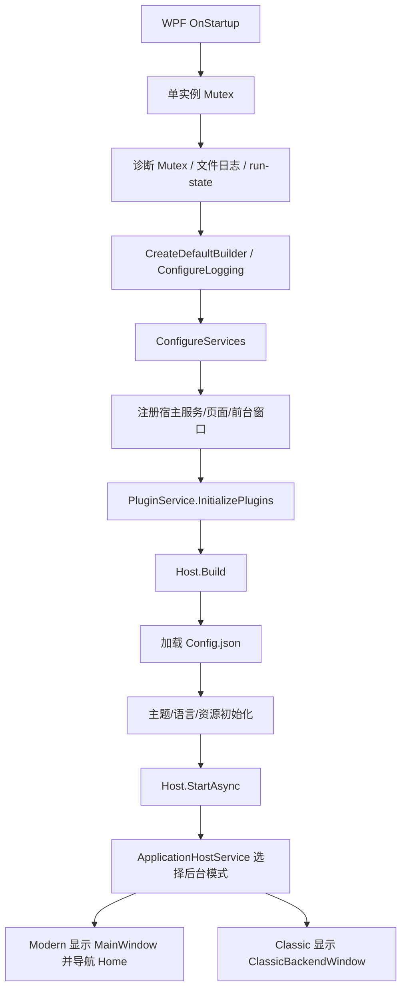

# 运行时架构

## 技术栈

主应用是 .NET 10 WPF 应用，目标框架为 `net10.0-windows10.0.20348`。当前代码使用 WPF-UI、Generic Host、Microsoft DI、自定义文件日志（`FileLoggerProvider`）、WPFLocalizeExtension、YamlDotNet 和自定义插件 SDK。OpenCvSharp、PaddleOCR、PaddleInference 等 SmartBP 重型依赖位于 `neo-bpsys-wpf.SmartBp.Module`，不由 lite 主应用直接引用。

## 启动流程

入口在 `neo-bpsys-wpf/App.xaml.cs`：

1. 检查 64 位进程，设置 UTF-8 控制台编码与 Initializing 状态，获取单实例 Mutex。已有实例时优先转发启动参数中的 BPUI 路径，成功转发后退出；否则提示已运行并退出。
2. 获取诊断 Mutex（最多等待 45 秒），初始化文件日志与 run-state，再创建 Generic Host：ConfigureLogging、ConfigureServices（含插件 Initialize）、Build。日志在 Host build 前已可记录失败。
3. 调用 base.OnStartup，设置动画帧率；进入 StartingOffline，加载 Config（含显式 legacy 启动迁移），检查文件关联，应用日志级别及教程调试状态，建立设置/业务事件订阅。
4. 进入 StartingOnline，初始化图标、主题与语言；await Host.StartAsync，由 ApplicationHostService 选择后台 Shell。
5. 刷新活动包自定义窗口注册，启动 BPUI 文件激活监听，异步处理初始包路径；启动受异常保护的公告同步，发送 AppStarted，再进入 Running。
6. 启动更新检查受 !DEBUG && !PREVIEW 条件编译控制。文件激活与包导入契约见 [BPUI](../frontend/bpui-package-v3.md)，公告流程见[远程公告](remote-announcements.md)。

退出时 `OnExit` 先记录 ShutdownRequested，再发送 `AppStopping`，有期限地同步等待 Host 停止并释放；成功完成后才记录 ShutdownCompleted 和关闭日志，再归档。异常和超时不标记正常完成。重启新进程通过独立诊断 Mutex 等待旧进程完成归档。

当前启动链可以简化为：



`App` 继承 `AppBase`。`AppBase` 提供 `Restart()`、`ShutDown()`、`AppStarted`、`AppStopping` 和 `CurrentLifetime` 抽象。`IAppHost.Host` 是 Core 层暴露的静态 Host 引用，插件和部分后台代码通过它访问 DI 容器。

## WPF + Generic Host

`App.Services.xaml.cs` 是服务注册中心。这里将 WPF 页面、窗口和业务服务都放入 Microsoft DI 容器。Modern 主窗口通过 `INavigationWindow` 注册为单例，构造时注入导航、InfoBar、Snackbar、设置服务和 logger。

当前大多数 View、ViewModel、Service 是 singleton。维护时不要随意改生命周期，因为 WPF 绑定、导航页面缓存、前台窗口状态和共享数据都依赖这种长期实例模型。

实验性 Web Renderer 作为插件注册 IHostedService，根据插件设置和启动参数决定是否启动 sidecar，默认不随应用启动。它的异常、runtime 缺失和端口占用均为 fail-safe 状态，不影响 WPF Host 生命周期。

SmartBP 是特殊边界：宿主 DI 只注册页面壳、`SmartBpModuleManager`、`ISmartBpFeatureService` 和 OCR 模型路径提供器。真实 SmartBP 页面内容由模块程序集在成功加载后通过 `ISmartBpModuleEntryPoint` 创建，宿主不直接引用模块实现类型。

## 日志

日志目录来自 `AppConstants.LogPath`：

```text
%APPDATA%\neo-bpsys-wpf\Log
```

日志由自定义 `FileLoggerProvider`（`neo-bpsys-wpf/Logging/FileLoggerProvider.cs`）实现，通过 `Microsoft.Extensions.Logging` 的 `ILogger<T>` 抽象向全应用提供。当前运行的日志始终写入 `latest.txt`，并在文件开头记录本次启动时间；应用正常退出时 `App.OnExit` 调用 `FileLoggerProvider.FinalizeRun()` 将其按启动时间归档为 `log-YYYYMMDD_HHMMSS.txt`。若上次运行因故障未正常退出，`latest.txt` 会被保留，下次启动时读取其头部记录的启动时间完成归档（读取不到时回退到文件最后写入时间），并清理旧文件只保留最近 10 次运行的归档日志。初始日志级别在 Host 构建前从 `Config.json` 的 `LogLevel` 字段读取，设置加载后通过 `App.ApplyLogLevel(...)` → `FileLoggerProvider.SetLevel(...)` 动态应用。

全局异常入口在 App 构造时注册，文件日志及运行状态在单实例/诊断锁取得后、Host 构建前初始化。Error/Critical 始终保留；少量运行诊断绕过普通级别过滤，仍复用同一文件追加机制。日志失败不抛出，诊断/错误尽力写入临时目录的紧急文件。运行状态、异常语义和用户手动启用 WER Dump 的步骤见 [异常退出与本地 Dump 收集](../diagnostics/crash-collection.md)。

## 设置、主题与语言

设置文件路径是：

```text
%APPDATA%\neo-bpsys-wpf\Config.json
```

`SettingsHostService` 负责读写。无参数重置恢复 `Settings` 默认值并保存一次，不改变活动布局包；设置替换通知页面重新订阅，新语言通过语言事件传播。窗口级重置与旧 `ISettingsMigrationService` 仅保留 Obsolete 空壳，不再执行操作。保存时会把当前用户 AppData 路径替换成 `%APPDATA%`，降低配置跨机器或用户名变化时的路径耦合。

主题启动时固定应用深色：`ApplicationThemeManager.Apply(ApplicationTheme.Dark)`。主题切换会更新 `IconThemesDictionary`。

语言由 `Settings.Language` 推导 `CultureInfo`。启动时设置：

```csharp
LocalizeDictionary.Instance.Culture = settingService.Settings.CultureInfo;
Application.Current.Resources["CurrentLanguage"] =
    XmlLanguage.GetLanguage(settingService.Settings.CultureInfo.Name);
```

新增用户可见文本应放入 `Locales` 下对应功能域的 resx 字典及其语言资源，沿用 `AppI18nDictionaries` 和现有 XAML 本地化入口。

## ApplicationHostService

`ApplicationHostService` 是 `IHostedService`。Host 启动后它会：

1. 注册教程标记，读取 IsClassicMode。
2. Classic 模式解析并显示 ClassicBackendWindow 后返回。
3. Modern 模式解析 INavigationWindow，显示 MainWindow 并导航 HomePage。Pick/Ban 预加载目前只在注释中，不执行。

这是 UI 启动链的一部分，不是后台服务进程。

## 插件初始化为何在 Host Build 前

`ConfigureServices` 的最后调用：

```csharp
PluginService.InitializePlugins(context, services);
```

插件的 `Initialize(context, services)` 能注册后台页面、前台窗口 registration、Designer v3 插件控件、自定义服务等。这些注册必须发生在 `Host.Build()` 前，否则 DI 容器已经冻结，插件无法参与 WPF-UI 页面提供器、窗口构造和服务解析。

因此插件安装/更新后通常需要重启应用。插件包被复制到插件目录不等于它已经进入当前进程的 DI 容器。
