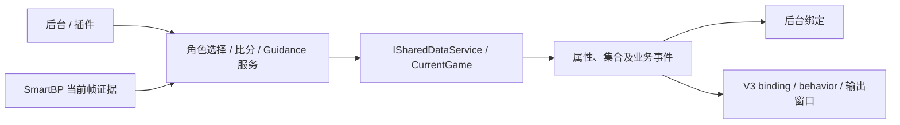

# 共享数据与状态流

本文负责 ISharedDataService 的权威状态与通知语义；SmartBP 算法、比分计算和布局格式分别在各模块文档维护。

源码入口：[接口](../../neo-bpsys-wpf.Core/Abstractions/Services/ISharedDataService.cs)、[SharedDataService](../../neo-bpsys-wpf/Services/SharedDataService.cs)、[Game/Team/Player](../../neo-bpsys-wpf.Core/Models)、[CharacterSelectionService](../../neo-bpsys-wpf/Services/CharacterSelectionService.cs)。

## 数据流



WPF 会沿可观察属性重新解析绑定，但 ViewModel 若只用转发 getter 暴露 CurrentGame，就须在 CurrentGameChanged 后通知该 getter；缓存旧 Game 或只监听旧对象不会自动转移订阅。集合内容通知与整个集合/对象引用替换是两种变更，不能用一个属性事件替代所有层级通知。普通路径走 WPF Binding，动态索引订阅规则见[控件绑定](../frontend/fronted-designer-v3.md)。

## 为什么 SharedDataService 是中心

`SharedDataService` 是导播后台、前台窗口、引导式 BP、比分、SmartBP 等功能的共享状态中心。它通过 `ISharedDataService` 暴露当前对局、主客队、角色字典、Ban 位可用状态、倒计时、BO3/BO5 状态和地图 V2 状态。

前台窗口 ViewModel 不应复制一份比赛状态，而应读取 `ISharedDataService`：

```csharp
public Game CurrentGame => _sharedDataService.CurrentGame;
public string RemainingSeconds => _sharedDataService.RemainingSeconds;
public ObservableCollection<bool> CanCurrentSurBanned => _sharedDataService.CanCurrentSurBannedList;
```

典型例子是旧 XAML 前台窗口 ViewModel 和当前 v3 renderer 绑定链路：它们读取 `ISharedDataService` 的当前状态，并在 `CurrentGameChanged`、`IsBo3ModeChanged`、`CountDownValueChanged` 等事件后刷新绑定或重新渲染需要切换状态的布局。

## 稳定对象与可替换对象

`HomeTeam` 和 `AwayTeam` 在接口注释中明确是“全场始终不变”的对象。导入队伍信息时使用 `Team.ImportTeamInfo(Team)` 更新对象内部内容，而不是替换 `HomeTeam` / `AwayTeam` 引用。

`Team.ColorHex` 是队伍展示色的权威字段，序列化格式统一为 `#AARRGGBB`。输入 `#RRGGBB` 时自动补全不透明 Alpha；主队和客队默认值分别为 `#FF337FB9`、`#FFE34341`。`ImportTeamInfo` 必须同步复制此字段，避免导入队伍或对局后丢失颜色。Designer v3 的颜色绑定可直接使用 `HomeTeam.ColorHex` 和 `AwayTeam.ColorHex`。

`CurrentGame` 则可能被替换：

| 操作 | 行为 |
| --- | --- |
| `NewGame()` | 根据当前主客队阵营创建新的 `Game`，保留地图和对局进度 |
| `ImportGameAsync(filePath)` | 导入对局 JSON，更新主客队信息，再构造新的 `Game` |
| `Game.Swap()` | 当前对局内部交换求生/监管队伍，并触发换边事件 |

`SharedDataService` 在替换 `CurrentGame` 时会先取消旧对局事件订阅，再订阅新对局事件，并触发 `CurrentGameChanged`。页面如果缓存了旧 `Game` 引用，可能会读到过期状态。

## Game / Team / Player 数据关系

| 模型 | 职责 |
| --- | --- |
| `Game` | 当前局信息：队伍、进度、地图、当前 Ban、上场选手、赛后数据 |
| `Team` | 主队/客队数据：名称、Logo、队员、比分、全局 Ban 记录 |
| `Player` | 当前上场选手：成员、角色、天赋、辅助特质、赛后数据 |
| `PlayerData` | 赛后数据字段，空值显示为 `-` |

`Game` 构造时会基于 `SurTeam.SurMemberOnFieldCollection` 和 `HunTeam.HunMemberOnField` 创建 `Player`，并在队员上场变化时重新装填成员引用。

## Ban 状态

`SharedDataService` 维护四个“是否可用”的 Ban 位列表：

| 列表 | 长度来源 |
| --- | --- |
| `CanCurrentSurBannedList` | `AppConstants.CurrentBanSurCount` |
| `CanCurrentHunBannedList` | `AppConstants.CurrentBanHunCount` |
| `CanGlobalSurBannedList` | `AppConstants.GlobalBanSurCount` |
| `CanGlobalHunBannedList` | `AppConstants.GlobalBanHunCount` |

`SetBanCount` 通过把前 N 个位置设为 `true` 来控制页面可用 Ban 位。列表项变化会触发 `BanCountChanged`。引导式 BP 启动时会根据 `GameRule.json` 调整这些列表。

当前局禁用角色存储在 `CurrentGame.CurrentSurBannedList` 和 `CurrentGame.CurrentHunBannedList`。

全局 Ban 有两层数据：

| 列表 | 语义 |
| --- | --- |
| `Team.GlobalBannedSurList` / `GlobalBannedHunList` | 当前已经生效的全局禁选，是前台显示和选择器禁用判断的权威源 |
| `Team.GlobalBannedSurRecordList` / `GlobalBannedHunRecordList` | 本轮该阵营 Pick 的暂存记录，供下一次队伍再次轮到该阵营时写入生效列表 |

角色选择服务自动记录 Pick 时只写入 `RecordList`，不会立即改变当前生效的全局禁选。队伍再次轮到对应阵营、新建对局或启动引导时，`UpdateGlobalBanFromRecord()` 才会把暂存记录中的非空角色覆盖到当前生效列表。

### 角色禁用状态联动

`CharaSelectViewModelBase` 提供了 `DisabledKeys` 属性（`ISet<string>`），实时计算当前对局中同阵营已被 Ban 或已被 Pick 的角色名集合，用于在 `CharacterSelector` 下拉列表中灰显这些选项。

| 场景 | 被禁用的角色 |
| --- | --- |
| 求生者 Ban / Pick 位 | 已启用的 `CurrentSurBannedList` + `CurrentGame.SurTeam.GlobalBannedSurList` + `SurPlayerList` 中已 Pick 的角色 |
| 监管者 Ban / Pick 位 | 已启用的 `CurrentHunBannedList` + `CurrentGame.HunTeam.GlobalBannedHunList` + `HunPlayer.Character`（若非空） |

数据流：

```
CurrentGame.BannedList / Player.Character 变化
  → CollectionChanged / PropertyChanged 事件（Game 级别）
    ─────────────────────────────────────────────
SharedDataService.HomeTeam/AwayTeam.GlobalBannedSur(Hun)List 变化
  → CollectionChanged 事件（当前生效列表为权威源）
    ─────────────────────────────────────────────
    → CharaSelectViewModelBase.UpdateDisabledKeys()
      → DisabledKeys 属性变更
        → CharacterSelector.DisabledKeys DP
          → ComboBox.ItemContainerStyle (MultiBinding)
            → ComboBoxItem.IsEnabled = false
```

`UpdateDisabledKeys` 只读取当前阵营队伍的 **生效列表（GlobalBanned*List）**，不会读取或订阅 `RecordList`。因此本轮 Pick 写入暂存记录后不会立即干扰 Ban/Pick；等队伍下一次轮到相同阵营、暂存记录覆盖到生效列表后，角色才会被禁用。读取时额外校验 `team.Camp` 与当前阵营一致，并在 `TeamSwapped` 完成态再次刷新，避免 `Game.Swap()` 先换 Camp、后换引用的中间态留下错误结果。

由此得到统一计算规则：

```
当前阵营 DisabledKeys
  = 当前阵营已启用的当局 Ban
  + 当前阵营队伍已启用的生效全局 Ban
  + 当前阵营本局已 Pick 的角色
```

`RecordList`、另一支队伍的生效全局 Ban、已关闭 Ban 位中的角色，都不参与当前阵营的 `DisabledKeys`。

导入对局（`ImportGameAsync`）恢复的是当前生效状态。`ImportTeamInfo` 在稳定的生效列表对象内更新内容，保证已有 ViewModel 的集合订阅继续有效；导入后调用 `ClearGlobalBanRecords()` 清空导入前的暂存记录，避免创建新 `Game` 时旧记录覆盖导入的生效列表。

设计原则：角色禁用状态是**派生数据**，不存储在 `Character` 模型上，避免在 NewGame / ImportGame 等操作时需要额外清理。

> **例外**：PickPage 中用于查看和手动调整暂存记录的 CharacterSelector（`HomeSur/HunGlobalBanRecordViewModel`、`AwaySur/HunGlobalBanRecordViewModel`）不绑定 `DisabledKeys`，否则暂存记录自身会阻止修正。

## 倒计时

倒计时使用 WPF `DispatcherTimer`，因此 Tick 发生在 UI 线程。状态字段是 `_remainingSeconds`：

| 方法/属性 | 行为 |
| --- | --- |
| `TimerStart(int? seconds)` | `null` 时不启动；否则设置剩余秒数、总秒数并启动计时器 |
| `TimerStop()` | 设置剩余秒数为 `-1`、总秒数为 `0`，停止计时器 |
| `RemainingSeconds` | 小于 0 显示 `VS`，否则显示数字 |
| `CountDownRemainingSeconds` | 供数值计算使用的剩余秒数；未运行时为 `0`，不返回 `VS` |
| `CountDownTotalSeconds` | 当前轮倒计时启动时设置的总秒数；未运行时为 `0` |
| `CountDownValueChanged` | 每次变化后触发 |

后台页面和前台窗口不要自己创建独立倒计时，否则会和全局状态不同步。

## BO3/BO5 与比分

`IsBo3Mode` 在 `SharedDataService` 中集中保存。变更时会：

1. 发送 `PropertyChangedMessage<bool>`。
2. 触发 `IsBo3ModeChanged`。

`ScorePageViewModel` 不再维护后台比分页专用的 BO3/BO5 Game/half 选择列表；比分控制跟随全局 `CurrentGame.GameProgress`。Designer v3 layout 可启用通用 BO3/BO5 Canvas states：root/default state 表示 BO5，`BoModeStates["Bo3"]` 表示 BO3。前台 v3 窗口在 `IsBo3ModeChanged` 后重载 layout，renderer 按 `ISharedDataService.IsBo3Mode` 选择对应 state；缺少 BO3 state 时回退 root/BO5 并记录 warning。`ScoreGlobalWindow` 只是该通用机制的一个使用者，背景、总分位置和控件配置不再通过 ScoreGlobal 专用 background variant 切换。`FrontedWindowService` 不再直接隐藏全局比分控件或移动 Total 控件。

`GlobalScoreTotalMargin` 仍在共享服务中暴露并保留设置项，但 v3 `ScoreGlobalWindow` 不依赖它；BO5/BO3 总分位置分别来自 root state 和 `BoModeStates["Bo3"]`。

Score System v2 的设计见 [score-system-v2.md](../business/score-system-v2.md)。权威比分状态由现有 `Core.Models.Game.MatchScore` 持有，类型为 `MatchScoreState`。其中 `Games` 是普通进度的 V2 半场记录，`FreeScore` 是 `GameProgress.Free` 专用的独立持久化状态；二者只共享既有前台派生绑定，不互相写入或换算。`IMatchScoreService` 根据当前进度分流操作，页面 ViewModel、前台窗口、`FrontedWindowService` 和 UI 控件都不能成为比分数据库。自由模式的两个手动编辑器使用活动 v3 布局直接修改 `FreeScore`，替换当前 Game 或离开自由模式时立即关闭。运行时不把任何 `MatchScoreState` 派生值同步回 `Team.Score`；`Team.Score` 仅用于旧 JSON/旧 DTO 的反序列化兼容。

## SmartBP 与共享状态的边界

BP 识别不持有第二份长期业务状态；视觉证据是输入，CurrentGame 角色与 BpSlotCommitState 是权威。提交状态绑定 Game.Guid + GameProgress，区分 Pending、CommittedEmpty、CommittedCharacter；旧 JSON 缺该字段时保持 Pending，普通 null 不能猜成已提交空操作。后台和 SmartBP 都通过 ICharacterSelectionService 修改，赛后 OCR 则在上下文复核后回填 PlayerData。自动追赶、手动同步、历史帧与角色名称契约统一见 [SmartBP](../business/smartbp-and-ocr.md)。

NewGame clone 当前 MatchScore（含普通与自由状态），不与旧对局共享可变实例。旧 JSON 的默认状态、FreeScore 缺失及 Team.Score 只读兼容规则见[比分持久化契约](../business/score-system-v2.md)。

## 事件模式

`ISharedDataService` 暴露的事件包括：

| 事件 | 常见用途 |
| --- | --- |
| `CurrentGameChanged` | 页面/前台窗口刷新 `CurrentGame` |
| `GameProgressChanged` | 当前 `CurrentGame.GameProgress` 改变或导入/替换为不同进度的对局后刷新进度相关 UI |
| `BanCountChanged` | Ban 页或前台控件刷新可用位 |
| `CountDownValueChanged` | 倒计时显示刷新 |
| `TeamSwapped` | 队伍换边后刷新阵营相关 UI |
| `IsBo3ModeChanged` | 切换 BO3/BO5 布局与比分 |
| `PickedMapChanged` | 地图显示刷新 |
| `MapV2BannedChanged` | 地图 V2 禁用状态刷新 |
| `IsMapV2BreathingChanged` / `IsMapV2CampVisibleChanged` | 地图 V2 前台表现刷新 |
| `MapV2PickingBorderStateChanged` | 按地图发布 MapBpV2 选图边框状态，payload 包含 `MapKey`、`IsMapV2Breathing`、`IsMapBanned`、`IsPickingBorderVisible`；`IsPickingBorderVisible` 保持旧语义 `IsMapV2Breathing && !IsMapBanned`，由 v3 行为负责具体动画。 |

因为页面和 ViewModel 多为 singleton，订阅事件时要避免重复订阅，也要注意长期订阅导致对象被持有。构造函数中订阅 singleton 服务事件通常可接受；动态创建对象订阅时需要考虑解绑。

## 维护坑点

1. 不要在页面 ViewModel 中复制 `CurrentGame` 的深层状态作为第二数据源。
2. 替换 `CurrentGame` 后，旧对象引用不会再收到共享服务事件。
3. 导入队伍应通过 `ImportTeamInfo`，不要替换 `HomeTeam` / `AwayTeam`。
4. 全局 Ban 有“记录列表”和“显示列表”两层，修改时要确认目标是哪一层。
5. `ObservableCollection` 应在 UI 线程更新；后台回调更新集合前先看 [threading-dispatcher-and-async.md](threading-dispatcher-and-async.md)。
6. SmartBP 写回赛后数据时直接修改 `CurrentGame` 中的 `PlayerData`；BP 识别写回统一经过 `ICharacterSelectionService`，不要维护 OCR 专用业务数据副本。
7. 导入对局（`ImportGameAsync`）后必须清空旧的 `RecordList` 暂存记录，不能把导入的生效列表反写到记录列表。
