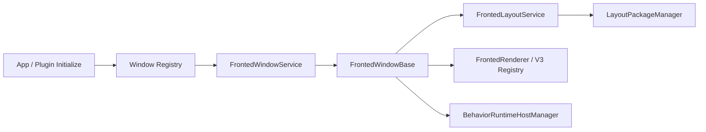

# 前台窗口源码阅读地图

本文是按需源码导航，不重复[窗口运行时契约](frontend-windows-and-layout.md)。排查具体问题时选择一条调用链，再读对应方法及测试。

## 依赖方向

## 调用链与入口

| 调试目标 | 从哪里读 | 接着读 |
| --- | --- | --- |
| 内置窗口缺失 | [App DI](../../neo-bpsys-wpf/App.Services.xaml.cs) 的 AddFrontedV3LayoutWindow | [v3 注册扩展](../../neo-bpsys-wpf.Core/Extensions/Registry/FrontedV3LayoutWindowRegistryExtensions.cs) → [Registry](../../neo-bpsys-wpf.Core/Services/Registry/FrontedWindowRegistryService.cs) |
| 插件 XAML 注册 / DataContext | [XAML 注册扩展](../../neo-bpsys-wpf.Core/Extensions/Registry/FrontedWindowRegistryExtensions.cs) | [插件加载](../../neo-bpsys-wpf/Services/PluginService.cs) → [身份生成](../../neo-bpsys-wpf.Core/Services/FrontedLayout/FrontedWindowIdentity.cs) |
| 第一次显示 | [WindowService](../../neo-bpsys-wpf/Services/FrontedWindowService.cs) 的 ShowWindowCoreAsync | EnsureWindowCreated → CreateWindow → [Base](../../neo-bpsys-wpf.Core/Controls/FrontedWindowBase.cs) 的 EnsureInitialWindowSettingsAppliedAsync → Show → LoadOrReloadContentAsync |
| 布局来源不对 | [LayoutService](../../neo-bpsys-wpf.Core/Services/FrontedLayout/FrontedLayoutService.cs) 的 LoadWindowConfigWithMetadataAsync | [PackageManager](../../neo-bpsys-wpf.Core/Services/FrontedLayout/FrontedLayoutPackageManager.cs) 的 GetActivePackageStateAsync / GetPackageLayoutPath |
| 包切换 / 透明度 | [WindowService](../../neo-bpsys-wpf/Services/FrontedWindowService.cs) 的 ReloadFrontedLayoutsAsync | GetRequestedAllowsTransparencyAsync → RestartWindowForTransparencyChangeAsync 或 ReloadFrontedLayoutAsync |
| 图片 / 控件 / 名称残留 | [Renderer](../../neo-bpsys-wpf.Core/Services/FrontedLayout/FrontedRenderer.cs) | [V3 Host](../../neo-bpsys-wpf.Core/Services/FrontedLayout/V3/FrontedV3ControlHost.cs)、[资源 resolver](../../neo-bpsys-wpf.Core/Services/FrontedLayout/FrontedResourceResolver.cs) |
| 隐藏后动画重复 / 关闭仍引用窗口 | [Base](../../neo-bpsys-wpf.Core/Controls/FrontedWindowBase.cs) 的 AttachBehaviorRuntimeAsync / DetachBehaviorRuntimeCoreAsync | [HostManager](../../neo-bpsys-wpf.Core/Services/FrontedLayout/FrontedBehaviorRuntimeHostManager.cs) 的 Attach / Detach / Dispose |
| 编辑保存到错误窗口 | [编辑器 LayoutLifecycle](../../neo-bpsys-wpf/ViewModels/Windows/FrontedDesignerWindowViewModel.LayoutLifecycle.cs) | [CanvasAndWindowOptions](../../neo-bpsys-wpf/ViewModels/Windows/FrontedDesignerWindowViewModel.CanvasAndWindowOptions.cs) / [DocumentState](../../neo-bpsys-wpf/ViewModels/Windows/FrontedDesignerWindowViewModel.DocumentState.cs) |

## 容易漏掉的检查

- Registry 描述“可以创建什么”，WindowService 字典描述“已创建什么”；查名称或隐藏不能顺手创建实例。
- v3 必须在 source 初始化前应用透明窗口选项，内容渲染在 Show 后；不要把两段合并成一次晚到的 reload。
- 隐藏不是销毁。真正释放走 service close；异步 attach 的完成必须再次确认窗口 lifetime 与可见性。
- 布局路径和活动包的真实读取规则见[数据模型](fronted-layout-v3-window-centric.md)，不能从旧 loose store 或已删除的 FrontedWindowRuntimeSettings 推导。
- XAML 插件窗口仍是合法路径，不能因内置窗口全部使用 v3 就移除它。

## 对应回归入口

[测试 Services](../../neo-bpsys-wpf.Tests/Services) 中的 FrontedWindowRegistryServiceTest、FrontedWindowServiceCanonicalIdTest、FrontedWindowServiceTransparencyRestartTest、FrontedLayoutPackageManagerTest、FrontedBehaviorRuntimeHostTest 分别保护注册/身份、透明度重建、包管理与异步宿主生命周期。测试执行见[验证与调试](../build/testing-and-debugging.md)。
